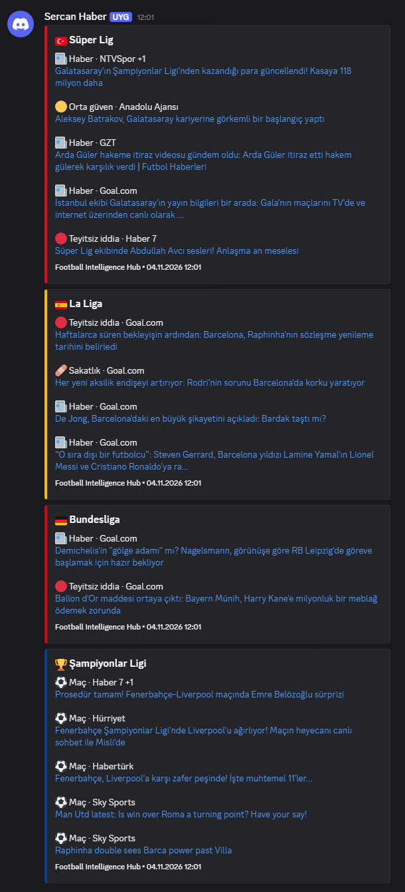
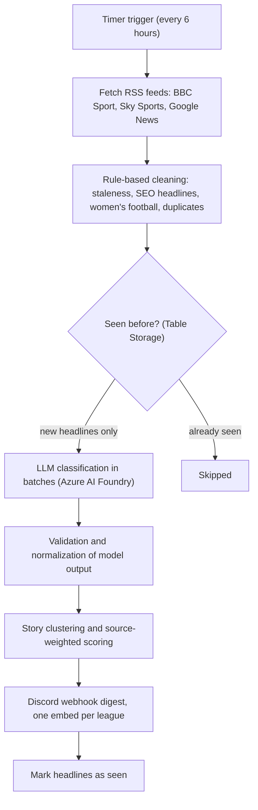

# Football Intelligence Hub

An AI-assisted football news digest bot. Every six hours it collects men's football headlines for the **Süper Lig, La Liga, Bundesliga and the Champions League**, filters out noise, classifies them with an open-weight LLM on **Azure AI Foundry**, scores how trustworthy each story is, and posts a digest to **Discord**.

> The reliability score is computed in code from source quality and cross-source corroboration. The LLM only classifies; it is never asked "is this true?".


## Features

- Collects headlines from BBC Sport, Sky Sports and Google News RSS searches (one search per league)
- Rule-based pre-filtering before anything reaches the LLM: stale items, ticket/stream/SEO headlines, women's football (out of scope), duplicates
- LLM classification: league, category (transfer, match, injury, betting, other) and a spam flag
- Groups headlines about the same event into one story and scores it by how many independent sources report it and how reliable they are
- Skips headlines it has already processed (Azure Table Storage), so nothing is analysed or posted twice
- Posts one Discord embed per league, with a trust badge on transfer rumours

## Architecture



## Tech stack

- C# / .NET 10 (Azure Functions, isolated worker model)
- Azure Functions with a timer trigger
- Azure AI Foundry, called through the `Azure.AI.Inference` package (currently an open-weight `gpt-oss-120b` deployment; the model is configuration, not code)
- Azure Table Storage for processed-headline tracking
- Discord webhooks for delivery
- Application Insights for logs

## Design decisions

**The model is a classifier, not an authority.** Its JSON output is parsed defensively, scores are clamped to the valid range, and league and category names are normalized in code. In early tests a small model confused a player's former league with the story's league and invented summaries, so summaries were dropped and league rules were tightened in the prompt and enforced in code.

**Reliability is computed, not guessed.** Each source has a tier (official, established, other). A story's score comes from the combined weight of the distinct sources reporting it. A transfer story without an official source is capped at medium trust, and a story the model flags as clickbait with no official source stays at the lowest tier. Trust badges are only shown for transfer stories, where source reliability matters most.

**Cost control.** Cheap code filters run before the LLM, there is a per-feed cap, headlines go to the model in batches of 15, `429` responses are retried with backoff, and already-seen headlines are never sent again.

**Failure isolation.** A broken feed is skipped without stopping the run. Storage or Discord errors are logged instead of crashing the function. Headlines are only marked as seen after at least one Discord message was delivered, so a failed run is retried next time.

**Secrets stay out of the repo.** Everything sensitive is read from environment variables. `local.settings.json` is git-ignored; `local.settings.example.json` shows the expected shape.

## Configuration

| Setting | Description |
|---|---|
| `AI_ENDPOINT` | Foundry resource endpoint, e.g. `https://<resource>.services.ai.azure.com/models` |
| `AI_KEY` | API key for that resource |
| `AI_MODEL` | Name of the model deployment |
| `DISCORD_WEBHOOK_URL` | Discord channel webhook URL |
| `DIGEST_SCHEDULE` | NCRONTAB expression, e.g. `0 0 */6 * * *` for every six hours |
| `AzureWebJobsStorage` | Storage connection string (set automatically in Azure) |
| `WEBSITE_TIME_ZONE` | Optional, e.g. `Turkey Standard Time`, so the schedule uses local time on Windows plans |

Copy `local.settings.example.json` to `local.settings.json` and fill in the values.

## Run locally

Requirements: .NET 10 SDK, Azure Functions Core Tools v4, and Azurite (storage emulator) for the timer trigger and Table Storage.

```bash
func start
```

Tip: while developing, set `DIGEST_SCHEDULE` to a date far in the future (for example `0 0 0 1 1 *`) so the timer does not fire and spend model tokens on its own.

## Deploy

```bash
az login
func azure functionapp publish <your-function-app-name>
```

Create the Function App first (the app was tested on the Consumption plan with the .NET 10 isolated runtime) and add the settings above as application settings.

## Known limitations and next steps

- Story clustering uses keyword overlap, so it can merge or miss related headlines. Embeddings would group them by meaning.
- Source tiers are hand-curated lists.
- The score measures corroboration across outlets, not truth. Outlets that copy a rumour from each other still count separately.
- X (Twitter) is not included because API access is paid. New sources only need to produce `NewsItem` records.
- No automated tests yet; the cleaning and scoring logic is the natural place to start.

## License

MIT
